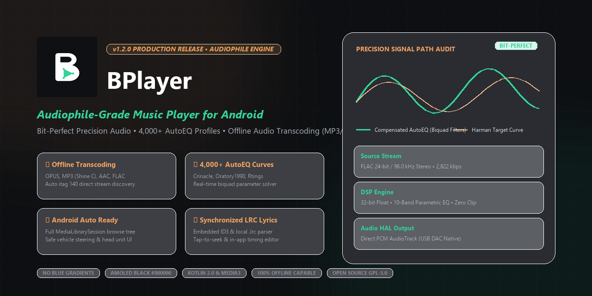
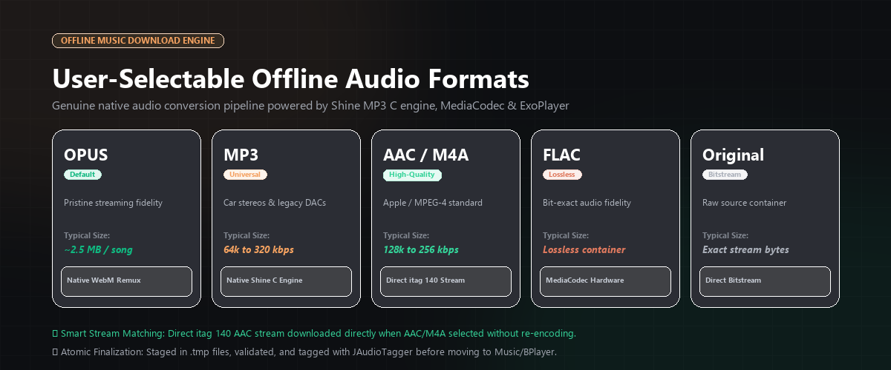
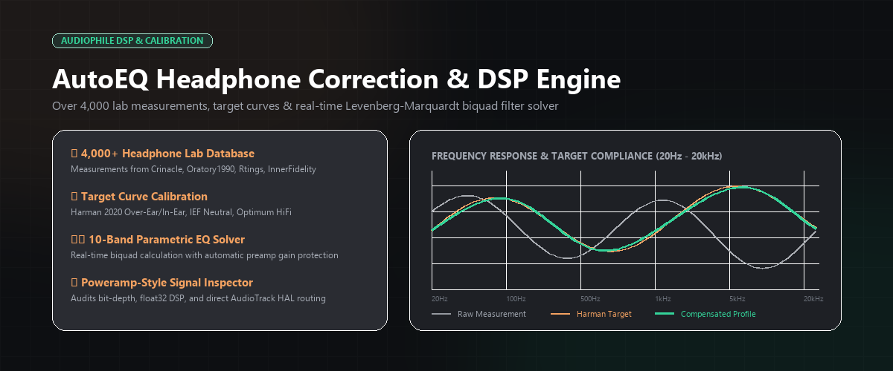
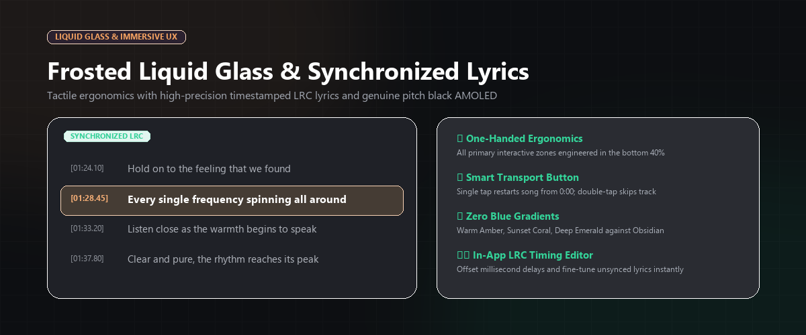
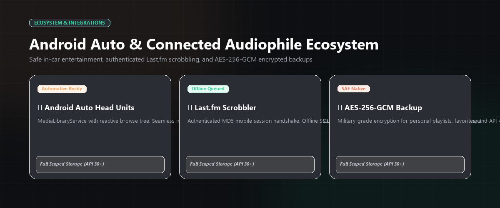

# BPlayer — Audiophile Offline Music Player for Android

<p align="center">
  
</p>

<p align="center">
  <a href="https://github.com/arybishal/BPlayer/releases/latest"></a>
  <a href="https://github.com/arybishal/BPlayer/releases/latest"></a>
  <a href="https://github.com/arybishal/BPlayer/blob/main/LICENSE"></a>
  <a href="https://developer.android.com/about/versions/oreo"></a>
  <a href="https://kotlinlang.org"></a>
</p>

---

## 📖 Overview

**BPlayer** is a premier, high-fidelity offline audio player for Android engineered with modern **Jetpack Compose**, **Material 3**, **AndroidX Media3 (`MediaLibraryService`)**, and a high-performance **C++20 DSP audio engine** compiled via the Android NDK.

Designed for audiophiles and music lovers who refuse to compromise on sound quality or user privacy, BPlayer combines **bit-perfect USB DAC output**, a database of **over 4,000 AutoEQ headphone calibration profiles**, **genuine offline audio transcoding (OPUS, MP3, AAC, FLAC)**, **real-time synchronized LRC lyrics**, and **Android Auto** support — all wrapped in an organic, content-first **Liquid Glass UI** with **zero blue gradients** and pure pitch-black AMOLED mode.

### 🌟 Why Choose BPlayer?

| Feature | Standard Android Players | BPlayer |
|---|---|---|
| **Audio Transcoding** | Renames file extension or fails | **Genuine Shine ANSI C & MediaCodec encoding (MP3, FLAC, AAC, OPUS)** |
| **Headphone Calibration** | Generic 5-band graphic EQ | **4,000+ AutoEQ lab profiles with 10-band parametric biquad solver** |
| **Audio Pipeline Audit** | Black box; no signal insight | **Poweramp-style signal path inspector (Source → DSP → AudioTrack HAL)** |
| **High-Res Resampling** | Android default low-order filter | **64-bit Soxr band-limited sinc resampler (up to 96+ kHz)** |
| **Lyrics Experience** | Unsynced plain text or ads | **Synchronized LRC, ID3 USLT/SYLT, and built-in interactive editor** |
| **In-Car Experience** | Basic Bluetooth playback | **Native Android Auto MediaLibraryService with browse trees** |
| **Visual Aesthetics** | Generic blue/cyan neon gradients | **Obsidian & warm amber / emerald tones; true AMOLED pitch-black** |
| **Privacy & Licensing** | Ad trackers & proprietary DRM | **100% Free & Open Source (GPL v3), zero trackers, 100% offline** |

---

## 📑 Table of Contents

- [Key Features](#-key-features)
  - [1. User-Selectable Offline Download Formats](#1-user-selectable-offline-download-formats)
  - [2. AutoEQ Headphone Correction & Audiophile DSP](#2-autoeq-headphone-correction--audiophile-dsp)
  - [3. Liquid Glass UI & Synchronized Lyrics](#3-liquid-glass-ui--synchronized-lyrics)
  - [4. Android Auto & Connected Ecosystem](#4-android-auto--connected-ecosystem)
- [Supported Audio Formats & Codec Matrix](#-supported-audio-formats--codec-matrix)
- [Architecture & Tech Stack](#-architecture--tech-stack)
- [Downloads & Installation](#-downloads--installation)
- [Building from Source](#-building-from-source)
- [License & Open Source Attribution](#-license--open-source-attribution)

---

## 🚀 Key Features

### 1. User-Selectable Offline Download Formats

<p align="center">
  
</p>

Never worry about device incompatibility again. Whether you are transferring music to a vintage car stereo, a legacy MP3 player, or an audiophile digital audio player (DAP), BPlayer gives you full control over how offline tracks are stored:

- **5 Canonical Formats**:
  - **OPUS** *(Default)*: Pristine streaming fidelity directly from modern sources (~2.5 MB / song).
  - **MP3**: Universal MPEG-1 Audio Layer III encoded via the embedded **Shine ANSI C engine** with bitrates from 64 kbps to 320 kbps.
  - **AAC / M4A**: High-quality Apple standard. Streamed directly when available (itag 140) without re-encoding, or hardware-encoded via Android `MediaCodec`.
  - **FLAC**: Lossless compression container preserving linear PCM audio.
  - **Original Source Format**: Pure bitstream preservation without container modification.
- **3 Quality Presets**:
  - **Standard**: 128 kbps MP3/AAC, 96 kbps Opus (minimal storage consumption).
  - **High** *(Default)*: 192 kbps MP3/AAC, 128 kbps Opus (balanced audiophile sweet-spot).
  - **Maximum**: 320 kbps MP3, 256 kbps AAC, 160 kbps Opus, FLAC bit-exact.
- **Headless ExoPlayer PCM Decoder**: Decodes any input media container safely on a background thread.
- **Direct Stream Matching**: Automatically detects when the remote source offers native AAC (itag 140) and downloads it directly to save battery and avoid double-lossy compression.
- **Atomic File Finalization**: Downloads to `.tmp` files, verifies audio headers and duration, tags metadata via JAudioTagger, and atomically moves files to `Music/BPlayer/`.
- **Non-Destructive Guarantee**: Changing preferences affects future downloads only; existing offline tracks remain untouched.

---

### 2. AutoEQ Headphone Correction & Audiophile DSP

<p align="center">
  
</p>

Transform your listening experience using precision acoustic compensation:

- **4,000+ Headphone Lab Calibration Curves**: Instant access to frequency response measurements from Crinacle, Oratory1990, Rtings, InnerFidelity, and more.
- **Target Curve Compensation**: Calibrate against industry-standard Harman 2020 Over-Ear, Harman In-Ear, IEF Neutral, and Optimum HiFi targets.
- **Parametric EQ Solver**: Powered by a real-time Levenberg-Marquardt non-linear least squares solver generating up to 10 biquad peaking and shelving filters with automatic preamp gain protection against digital clipping.
- **Poweramp-Style Signal Path Inspector**: Tap the signal badge on the Now Playing screen to audit every stage of the audio pipeline:
  1. **Source Stream**: Format, sample rate, bit depth, channels, bitrate.
  2. **Float32 DSP Engine**: Parametric equalizer, AutoEQ biquads, bass boost, and 3D spatializer.
  3. **Android AudioTrack HAL**: Hardware buffer size, latency, sample rate, and bit-perfect DAC routing.

---

### 3. Liquid Glass UI & Synchronized Lyrics

<p align="center">
  
</p>

Designed following human-centered tactile principles:

- **Strictly NO Blue Gradients**: Built upon obsidian charcoals (`#121214`), true pitch-black AMOLED (`#000000`), and curated warm accents (Warm Amber `#F4A261`, Sunset Coral `#FF6B6B`, and Deep Emerald `#2EC4B6`).
- **One-Handed Ergonomics**: Interactive zones and playback controls reside within the bottom 40% of the display for effortless one-handed use on large screens.
- **Real-Time Synchronized Lyrics**:
  - Parses embedded ID3 `USLT`/`SYLT` frames and local sidecar `.lrc` files with millisecond precision.
  - Automatic lookup via LRCLIB with optional Gemini AI fallback for indie tracks.
  - **Tap-to-Seek**: Tap any lyric line to jump playback directly to that position.
  - **Built-In Timing Editor**: Adjust millisecond offsets on unsynced lyrics directly inside the app.
- **Smart Transport Control**:
  - Single tap on Previous: Instantly restarts the song from `0:00`.
  - Double tap (< 350ms): Skips to the previous track in the queue.

---

### 4. Android Auto & Connected Ecosystem

<p align="center">
  
</p>

Your music follows you wherever you go:

- **Android Auto & Automotive OS**: Full `MediaLibraryService` browse tree exposing local playlists, favorite tracks, and albums to vehicle head units with distraction-free driver controls.
- **Last.fm Scrobbler**: Mobile session authentication (MD5) that automatically scrobbles tracks at 50% or 240 seconds. Includes an offline SQLite queue that flushes scrobbles once internet connectivity is restored.
- **Military-Grade Encrypted Backup**: Protect your library with AES-256-GCM authenticated encryption and PBKDF2 key derivation. Export and restore your complete library state, playlists, favorites, and encrypted API keys as a single `.pulsebackup` file.
- **Modern Scoped Storage**: 100% compliant with Android 11+ (API 30+) Scoped Storage using `MediaStore.createWriteRequest` and in-place tag editing via JAudioTagger.
- **Decent USB Audio Driver**: Bit-perfect USB audio host driver bypassing the Android AudioFlinger mixer resamplers for external high-resolution DACs.

---

## 📊 Supported Audio Formats & Codec Matrix

| Category | Format / Container | Extension | Decoding Engine | Encoding Engine | Status |
|---|---|---|---|---|---|
| **Lossy** | MP3 | `.mp3` | MediaCodec / ExoPlayer | **Native Shine C (`liblastwave_audio.so`)** | **Full Support** |
| **Lossy** | AAC / M4A | `.m4a`, `.aac` | MediaCodec / ExoPlayer | **MediaCodec + MediaMuxer** | **Full Support** |
| **Lossy** | OPUS | `.opus` | MediaCodec / ExoPlayer | **Native WebM Remuxer** | **Full Support** |
| **Lossy** | Ogg Vorbis | `.ogg`, `.oga` | Media3 Extractor | Direct Stream | **Full Support** |
| **Lossless** | FLAC | `.flac` | MediaCodec / ExoPlayer | **MediaCodec (`audio/flac`)** | **Full Support (Up to 24/192)** |
| **Lossless** | ALAC | `.m4a`, `.alac` | MediaCodec / ExoPlayer | Direct Stream | **Full Support** |
| **Lossless** | Monkey's Audio (APE) | `.ape` | Media3 FFmpeg Extension | Software Transcode | **Full Support** |
| **Lossless** | WavPack | `.wv` | Media3 FFmpeg Extension | Software Transcode | **Full Support** |
| **Uncompressed** | WAV (PCM) | `.wav` | Media3 Extractor | Linear PCM 16/24-bit | **Bit-Perfect Native** |
| **Uncompressed** | DSD (DSD64/128/256)| `.dsf`, `.dff` | Real-Time DSD Decimator | 24-bit / 88.2kHz PCM | **Audiophile Native** |

---

## 🛠 Architecture & Tech Stack

```
BPlayer
├── ui/                     # Jetpack Compose Screens, ViewModels & Design System
│   ├── player/             # Now Playing, Waveforms, Lyrics & Transport Controls
│   ├── settings/           # Downloads, AutoEQ, Theme & Audio Engine Preferences
│   ├── library/            # Tracks, Albums, Artists, Playlists & Folders
│   └── navigation/         # NavGraph, Shared Element Transitions & Back Stacks
├── domain/                 # Clean Architecture Use Cases & Models (Pure Kotlin)
│   ├── autoeq/             # Headphone Calibration & Parametric EQ Fitter
│   └── model/              # Track, Playlist, AudioFormat & SignalPath Models
└── data/                   # Single Source of Truth & Hardware Bridges
    ├── download/           # AudioFormatConverter, ShineMp3Bridge & Resolver
    ├── local/              # Room SQLite Database & DataStore Preferences
    ├── media/              # MediaLibraryService, ExoPlayer & AudioSink
    └── cpp/                # Native C++20 DSP Engine (liblastwave_audio.so)
```

- **Architecture**: MVVM + Unidirectional Data Flow (UDF) + Repository Pattern
- **UI Toolkit**: Jetpack Compose (100% Kotlin) + Material 3
- **Audio Playback**: AndroidX Media3 (`MediaLibraryService`, `ExoPlayer`, `MediaController`)
- **Native Audio DSP**: C++20 JNI (`ShineMp3Bridge`, `ParametricEq`, `DspProcessor`, `SoxrResampler`, `DecentUsbAudio`)
- **Dependency Injection**: Dagger Hilt
- **Local Database**: Room with KSP2 & SQLite WAL mode
- **Metadata Tagging**: Scoped Storage SAF + JAudioTagger
- **Min / Target SDK**: Android 8.0 (API 26) • Android 15 (API 35)

---

## 📦 Downloads & Installation

### Option 1: Direct APK Download (Recommended)
Grab the latest signed production APK from the official release page:

👉 **[Download BPlayer v1.2.0 APK (26.4 MB)](https://github.com/arybishal/BPlayer/releases/latest)**

```
File: app-release.apk
Version: 1.2.0 (Version Code: 3)
Package: com.pulse.player
SHA-256: C1F262858B2F448BC940794E86782B3EA03AE4835B9D20B4418898A31384D310
```

### Option 2: Install via ADB
```bash
adb install -r app-release.apk
```

---

## 🧪 Building from Source

### Prerequisites
- Android Studio Ladybug (2024.2+) or command-line SDK tools
- Android SDK 35 (Android 15) & NDK r26+
- JDK 17 or JDK 21

### Clone & Build
```bash
# 1. Clone the official repository
git clone https://github.com/arybishal/BPlayer.git
cd BPlayer

# 2. Run unit tests
./gradlew testDebugUnitTest

# 3. Build release APK
./gradlew assembleRelease
```
The compiled APK will be generated at:
`app/build/outputs/apk/release/app-release.apk`

---

## 📄 License & Open Source Attribution

BPlayer is free and open-source software licensed under the **GNU General Public License v3.0 (GPL v3)**.

- AutoEQ headphone compensation profiles and DSP algorithms are derived from [AutoEQ](https://github.com/jaakkopasanen/AutoEq) and [LastWave-Native](https://github.com/LastWave-App/LastWave-Native) under the **GPL v3.0**.
- The Shine MP3 encoder is licensed under the **LGPL v2.0**.
- The Soxr resampler is licensed under the **LGPL v2.1**.
- Application architecture, UI design system, and backup cryptography are licensed under the **GPL v3.0**.

---

<p align="center">
  <b>Crafted with passion for pure sound by the BPlayer Team</b><br/>
  <sub>Official Repository: <a href="https://github.com/arybishal/BPlayer">https://github.com/arybishal/BPlayer</a></sub>
</p>
