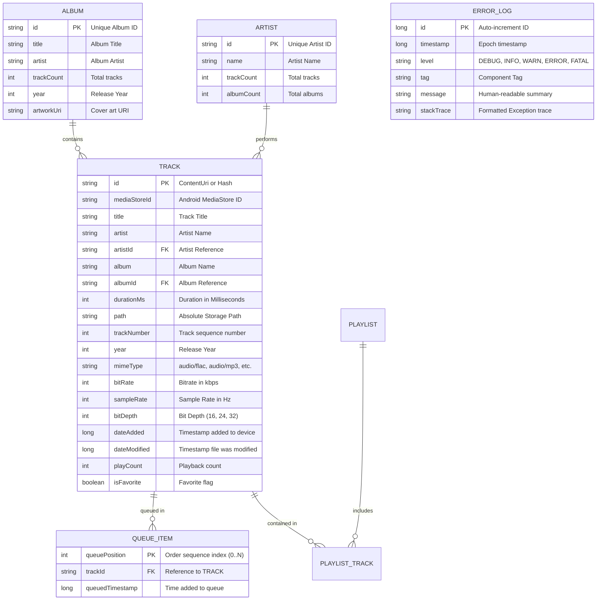
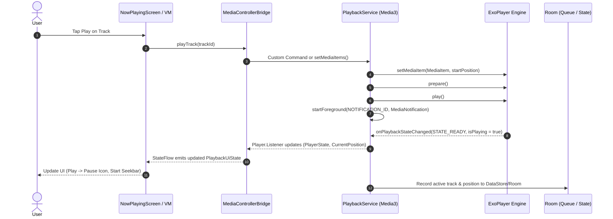
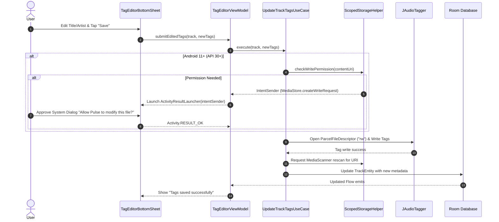
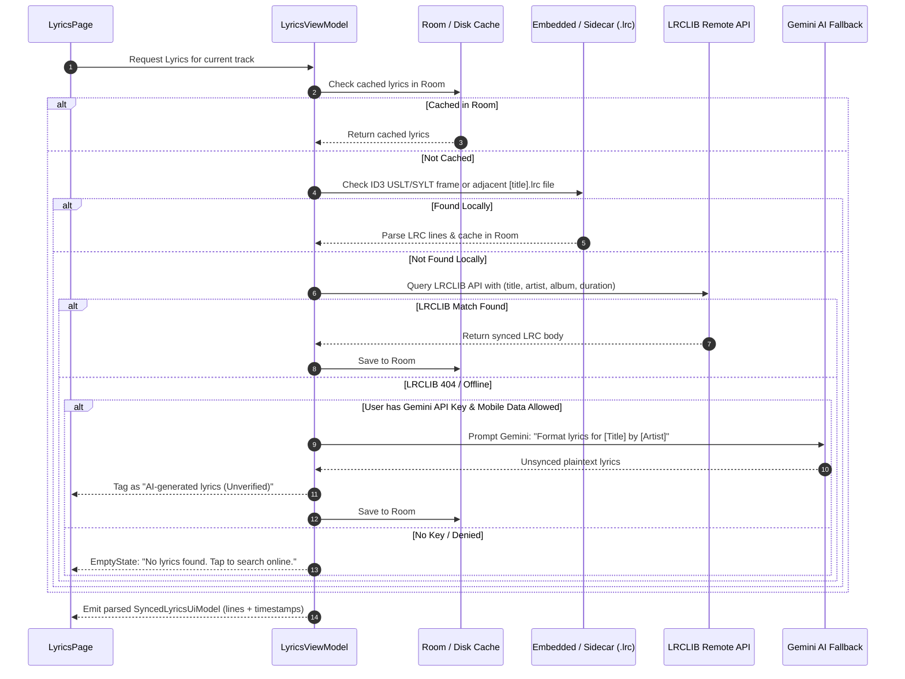

# Architecture & System Design — Pulse Music Player

## 1. High-Level Architecture Overview

Pulse is architected around **Clean Architecture principles** and **Unidirectional Data Flow (UDF)**. It enforces a strict separation of concerns across three primary layers: **UI**, **Domain**, and **Data**.

The playback engine is completely decoupled from the UI lifecycle: playback execution resides in an independent `MediaSessionService` running as an Android foreground service. Activities and Composables interact with playback exclusively through a persistent `MediaController` bridge.

```mermaid
graph TD
    subgraph UI_Layer["UI Layer (Jetpack Compose + ViewModels)"]
        Screens["Screens & Composables\n(Home, Library, NowPlaying, Settings)"]
        VMs["ViewModels\n(NowPlayingViewModel, LibraryViewModel, etc.)"]
        Screens -->|User Events| VMs
        VMs -->|UiState (Flow)| Screens
    end

    subgraph Domain_Layer["Domain Layer (Kotlin Business Logic)"]
        UseCases["Use Cases\n(PlayTrackUseCase, ScanLibraryUseCase,\nUpdateTagsUseCase, FetchLyricsUseCase)"]
        Models["Domain Models\n(Track, Album, Artist, QueueState)"]
        VMs -->|Invoke| UseCases
        UseCases --> Models
    end

    subgraph Data_Layer["Data Layer (Repositories & Drivers)"]
        Repo["Repositories\n(TrackRepository, PlaybackRepository,\nSettingsRepository, LyricsRepository)"]
        UseCases --> Repo
        
        RoomDB[("Room Database\n(tracks, albums, artists,\nqueue, error_logs)")]
        DataStore["DataStore\n(User Preferences)"]
        MediaStoreDriver["MediaStore & ContentResolver\n(Local Audio Files)"]
        NetworkClients["Network APIs\n(LRCLIB, MusicBrainz, Gemini, AudD)"]
        
        Repo --> RoomDB
        Repo --> DataStore
        Repo --> MediaStoreDriver
        Repo --> NetworkClients
    end

    subgraph Audio_Service["Playback Service (Foreground Service)"]
        MSS["PlaybackService (MediaSessionService)"]
        Exo["ExoPlayer (AndroidX Media3)"]
        AudioFX["Audio Effects\n(Equalizer, BassBoost, Virtualizer)"]
        Session["MediaSession (Media3)"]
        
        MSS --> Exo
        MSS --> AudioFX
        MSS --> Session
    end

    UI_Layer <-->|MediaController (IPC / Binder)| Session
    Repo -.->|Sync Playback Queue State| RoomDB
```

---

## 2. Package and Directory Structure

Pulse is designed with clean functional packaging to keep dependencies modular and testable:

```
com.pulse.player/
├── di/                                # Hilt Dependency Injection Modules
│   ├── AppModule.kt                   # Dispatchers, Application context, Logger
│   ├── DatabaseModule.kt              # Room database and DAOs
│   ├── MediaModule.kt                 # MediaController connection, Player bindings
│   ├── NetworkModule.kt               # OkHttp, Retrofit, Gemini API client
│   └── RepositoryModule.kt            # Repository implementations
├── domain/                            # Enterprise Domain Logic
│   ├── model/                         # Pure Kotlin Models (Track, Album, Lyrics, etc.)
│   ├── repository/                    # Repository Interfaces
│   └── usecase/                       # Single-responsibility Use Cases
│       ├── library/                   # ScanLibraryUseCase, SearchTracksUseCase
│       ├── playback/                  # PlayTrackUseCase, ManageQueueUseCase, SmartPreviousUseCase
│       ├── lyrics/                    # GetLyricsUseCase, SyncLyricsUseCase
│       └── metadata/                  # UpdateTrackTagsUseCase, DeleteTracksUseCase
├── data/                              # Concrete Implementations
│   ├── local/
│   │   ├── db/                        # Room Database, DAOs, Entities, TypeConverters
│   │   │   ├── dao/                   # TrackDao, AlbumDao, QueueDao, ErrorLogDao
│   │   │   ├── entity/                # TrackEntity, AlbumEntity, QueueItemEntity, ErrorLogEntity
│   │   │   └── PulseDatabase.kt
│   │   ├── datastore/                 # DataStore Preferences Manager
│   │   └── mediastore/                # MediaStore Audio Scanner & ContentResolver Bridge
│   ├── remote/                        # Network Clients & DTOs
│   │   ├── lrclib/                    # LRCLIB API Client
│   │   ├── musicbrainz/               # MusicBrainz & Cover Art Archive Client
│   │   ├── gemini/                    # Google Gemini Generative AI Client
│   │   └── recognition/               # AudD / ACRCloud Fingerprint Client
│   └── repository/                    # Concrete Repositories implementing Domain contracts
├── service/                           # Playback & Audio Engine
│   ├── PlaybackService.kt             # MediaSessionService implementation
│   ├── MediaNotificationProvider.kt   # Custom Media3 Notification manager
│   ├── AudioEffectsManager.kt         # Equalizer, Bass Boost, Virtualizer controller
│   └── controller/                    # MediaController Connection Manager
├── ui/                                # Presentation Layer (Compose)
│   ├── theme/                         # Color, Typography, Shape, Tokens, LiquidGlass
│   ├── components/                    # Reusable UI Elements (Seekbar, Artwork, Row, Sheets)
│   ├── navigation/                    # Navigation Graph, BottomBar, Screen routes
│   ├── home/                          # Home Dashboard Screen & ViewModel
│   ├── library/                       # Library Tabs (Tracks, Albums, Artists, Folders)
│   ├── player/                        # Hero 3-Page Now Playing & Queue Sheet
│   │   ├── PlayerPage.kt              # Page 1: Hero Cover, Controls, Seekbar
│   │   ├── LyricsPage.kt              # Page 2: Synchronized LRC viewer
│   │   └── ArtViewerPage.kt           # Page 3: High-Res zoomable artwork
│   ├── equalizer/                     # Equalizer screen & slider components
│   ├── settings/                      # Settings, Appearance, Battery & Error Log screens
│   └── common/                        # Error states, Empty states, Shimmers
└── util/                              # Cross-cutting Utilities
    ├── logger/                        # AppLogger & SQLite crash catcher
    ├── lrc/                           # High-precision LRC parser & timing calculator
    └── permissions/                   # Runtime Permission helper
```

---

## 3. Database Schema (Room)

Room acts as the **single source of truth** for library indexing, playlists, favorites, persistent playback queue, and diagnostic logs.



### Table Indices & Performance Strategy
- `TRACK`: Unique index on `path`, composite index on `(artist, album)`, index on `title`, index on `dateAdded`.
- `QUEUE_ITEM`: Primary key on `queuePosition` to allow instant atomic range updates during drag-and-drop operations.
- `ERROR_LOG`: Index on `timestamp` (descending) with an automated prune rule keeping maximum 500 recent entries.

---

## 4. Playback Service & MediaSession Lifecycle



### Key Service Invariants:
1. **Foreground Service Guarantee**: As soon as playback transitions to `STATE_BUFFERING` or `STATE_READY` with `playWhenReady = true`, the service promotes itself to foreground with `ServiceCompat.startForeground` using the `FOREGROUND_SERVICE_TYPE_MEDIA_PLAYBACK` flag.
2. **Audio Becoming Noisy**: A registered `BroadcastReceiver` listens for `AudioManager.ACTION_AUDIO_BECOMING_NOISY`. When headphones disconnect or Bluetooth disconnects, the receiver immediately invokes `ExoPlayer.pause()` to prevent unintended speaker playback.
3. **Audio Focus Handling**: The player requests `AUDIOFOCUS_GAIN` with `AudioAttributes.USAGE_MEDIA` and `CONTENT_TYPE_MUSIC`. Transient loss ducks volume smoothly; permanent loss halts playback and dismisses foreground status.

---

## 5. Sequence: Tag Editing & Scoped Storage Write Flow



---

## 6. Sequence: Synchronized Lyrics Resolution



---

## 7. Threading & Concurrency Model

Pulse strictly isolates thread pools according to I/O and computing profiles:

- **Dispatchers.Main (UI Thread)**:
  - Compose recompositions, layout passes, gesture detection, and UI state observation.
  - Zero disk reads, zero JSON parsing, zero database interactions permitted.
- **Dispatchers.IO (Storage & Network)**:
  - MediaStore queries, Room database read/write transactions, network API calls (LRCLIB, MusicBrainz), and JAudioTagger file manipulation.
- **Dispatchers.Default (High CPU Processing)**:
  - Palette color extraction, LRC timestamp string parsing, complex playlist sorting, and queue randomization algorithms.
- **Service Internal Handler Thread**:
  - ExoPlayer operations run on its dedicated internal playback looper thread to avoid UI stalling.

---

## 8. Caching Strategy

1. **Album Artwork**:
   - Two-tier memory and disk cache powered by **Coil**.
   - Custom `ImageLoader` configured with a 25% heap memory cache and 250MB disk cache in the application cache directory.
   - Cache keys use `trackId_lastModified` to invalidate cache immediately when embedded artwork is edited.
2. **Lyrics**:
   - Parsed lyrics stored directly in Room (`lyrics_cache` table) with TTL of 90 days.
3. **Library Metadata**:
   - MediaStore scanning produces a delta diff against Room using file `date_modified` and `size`. Only altered or new files are parsed for ID3 tags, allowing an incremental scan of 10,000 files in under 2 seconds.

---

## 9. Performance & Quality Targets

| Metric | Target | Measurement Strategy |
|---|---|---|
| **Cold App Launch** | < 1,500 ms | Macrobenchmark test from launcher icon to first interactive frame. |
| **List Scrolling** | 60 / 120 FPS | Compose `FrameTimingMetric` profiling on 10,000+ items with zero dropped frames. |
| **Incremental Scan** | < 2.0 s for 10k tracks | MediaStore diff query benchmark comparing modified timestamps. |
| **Memory Footprint** | < 120 MB idle, < 180 MB playing | Android Studio Memory Profiler during playback with blur effect enabled. |
| **Crash Rate** | < 0.01% sessions | Captured via SQLite `error_log` interceptor. |
