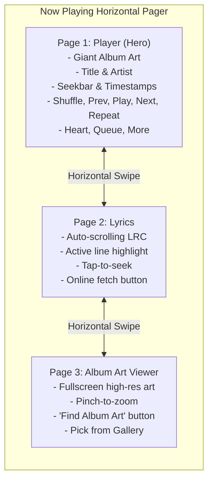

# UI/UX Design System Specification — BPlayer Music Player

## 1. Design Philosophy & Core Principles

BPlayer is built upon a philosophy of **calm, tactile minimalism and content celebration**. Where traditional media players clutter the screen with heavy frames, dense text badges, and flashy neon gradients, BPlayer treats album artwork and musical typography as the solitary focal point.

1. **Content First**: Album artwork is the hero element of the entire app. Interface chrome is quiet, translucent, and tonally harmonized with the current music.
2. **Icon-First Transport**: Transport controls and high-frequency actions use unmistakable, geometric iconography (Material Symbols Rounded) without redundant text labels. Text labels are reserved for menus, search results, and settings.
3. **One-Handed Ergonomics**: Critical interaction targets reside within the lower 40% of the display. Primary playback actions feature large touch radii (Play/Pause: 72–80dp; auxiliary buttons: ≥ 48dp).
4. **Fewer Taps to Music**: Any song in the user's library is playable within 1–2 taps. Secondary operations live inside intuitive swipe gestures or bottom sheet action sheets.
5. **Purposeful Motion**: Transitions are organic and physics-based. Animations communicate spatial relationships (e.g., mini-player expanding smoothly into full player via shared-element transitions) and respect system-level "Reduce Motion" toggles.
6. **Strict Ban on Blue Gradients**: Never use techy blue/cyan/purple linear gradient backgrounds. Surfaces are deep, warm, and natural.

---

## 2. Color System & Theming

### 2.1 Accent Color Proposals (User Choice)
We propose three warm/organic signature accent colors designed for high legibility and contrast against dark surfaces.

| Palette Name | Hex Code | HSL / Mood | Character & Persona Fit |
|---|---|---|---|
| **Option 1: Warm Amber / Terracotta (Default)** | `#E07A5F` / `#F4A261` | H: 14° S: 68% L: 62% | Earthy, warm, vinyl-record aesthetic; inviting, premium, gentle on eyes in dark rooms. |
| **Option 2: Sunset Coral** | `#FF6B6B` | H: 0° S: 100% L: 71% | Energetic, vibrant, modern, high-contrast; punchy transport controls. |
| **Option 3: Deep Emerald** | `#2EC4B6` / `#38B000` | H: 174° S: 62% L: 47% | Fresh, organic, tranquil; gives a clean acoustic hi-fi vibe. |

### 2.2 Semantic Color Tokens

```
========================================================================================
TOKEN               LIGHT THEME       DARK THEME (Default)   AMOLED BLACK THEME
========================================================================================
background          #F9F9FB           #121214                #000000
surface             #FFFFFF           #18181C                #0A0A0A
surfaceElevated     #F0F0F3           #222228                #141414
surfaceHighlight    #E4E4E9           #2E2E36                #1E1E1E
onSurface           #1A1A1E           #F0F0F5                #FFFFFF
onSurfaceMuted      #71717A           #9E9EA8                #8A8A93
onSurfaceSubtle     #A1A1AA           #5C5C66                #4D4D54
outline             #E4E4E7           #2A2A32                #222222
outlineVariant      #D4D4D8           #3A3A44                #2E2E2E
accent              #E07A5F (or User) #F4A261 (or User)      #F4A261 (or User)
onAccent            #FFFFFF           #1E1005                #1E1005
accentContainer     #FBE8E2           #3A2419                #2B180E
onAccentContainer   #6E2D18           #FFD8CC                #FFD8CC
danger              #E63946           #FF5A67                #FF5A67
success             #2A9D8F           #48CAE4                #48CAE4
scrimOverlay        #000000 (30%)     #000000 (60%)          #000000 (75%)
glassBorder         #FFFFFF (20%)     #FFFFFF (12%)          #FFFFFF (8%)
========================================================================================
```

### 2.3 Dynamic Color Extraction
When **Dynamic Color from Album Art** is active:
1. AndroidX Palette extracts `dominantSwatch`, `vibrantSwatch`, and `mutedSwatch`.
2. The extracted color is validated for WCAG AA compliance (contrast ratio ≥ 4.5:1 against `background`).
3. If contrast falls below 4.5:1, a lightness adjustment algorithm clamps the color value.
4. The validated color is mapped to `accent` and `accentContainer`, with soft ambient glow applied to the Now Playing backdrop.

---

## 3. Typography Hierarchy

The typographic system utilizes a bundled geometric sans-serif typeface: **Plus Jakarta Sans** (with Inter as fallback). All sizes in `sp` are scaled dynamically by the user-selected **Font Scale Multiplier** ($S$, configurable from 0.85 to 1.40 in Settings).

| Style Token | Weight | Base Size | Line Height | Tracking | Application Context |
|---|---|---|---|---|---|
| **Display** | Bold (700) | 28sp × $S$ | 34sp × $S$ | -0.5sp | Now Playing Hero Song Title (Large) |
| **Title** | SemiBold (600)| 20sp × $S$ | 26sp × $S$ | -0.2sp | Screen Headers, Album Details Title |
| **Subtitle** | Medium (500) | 16sp × $S$ | 22sp × $S$ | 0sp | Track List Row Title, Now Playing Artist |
| **Body** | Regular (400) | 14sp × $S$ | 20sp × $S$ | +0.1sp | Track List Artist/Album, Settings Details |
| **Label** | SemiBold (600)| 12sp × $S$ | 16sp × $S$ | +0.4sp | Elapsed/Remaining Timestamps, Category Tabs |
| **Caption** | Medium (500) | 11sp × $S$ | 14sp × $S$ | +0.5sp | Format Badges (FLAC 24/96), Audio Bitrates |

---

## 4. Shapes, Spacing & Elevations

### 4.1 Corner Radii
- **Extra Small (8dp)**: Format tags, badges, popup menus.
- **Small (12dp)**: Track row album art thumbnails, text field inputs, buttons.
- **Medium (20dp)**: Dialog containers, bottom sheet top edges, album grid cards.
- **Large (28dp)**: Now Playing hero album art, floating control pods.
- **Pill / Circular (999dp)**: Play/pause button, search bar, category chips, seekbar thumbs.

### 4.2 Spacing Grid (4dp Base)
- `2dp`: Micro padding (icon-to-badge spacing).
- `4dp`: Tight element separation.
- `8dp`: Standard component inner padding.
- `12dp`: Medium gap between related items.
- `16dp`: Screen edge margins, list item vertical spacing.
- `24dp`: Section separations.
- `32dp`: Hero element margins.

### 4.3 Elevation & Layering
Rather than heavy cast shadows, BPlayer employs **tonal elevation and translucency**:
- **Layer 0 (Base)**: `background` (canvas).
- **Layer 1 (Card/List)**: `surface` with 1dp `outline`.
- **Layer 2 (Floating Pods / Mini Player)**: `surfaceElevated` + optional frosted glass + soft ambient shadow (`elevation = 6dp`, `spotColor = Color.Black.copy(alpha = 0.25f)`).
- **Layer 3 (Modals / Bottom Sheets)**: `surfaceElevated` + scrim backdrop (`scrimOverlay`).

---

## 5. Liquid Glass / Frosted Translucency Specification

```
+-----------------------------------------------------------+
| Glass Surface Implementation (API 31+ vs Legacy)          |
+-----------------------------------------------------------+
| API 31+ (Android 12+):                                    |
|   Modifier.graphicsLayer {                                |
|     renderEffect = RenderEffect.createBlurEffect(         |
|       28f, 28f, Shader.TileMode.CLAMP                     |
|     ).asComposeRenderEffect()                             |
|   }                                                       |
|   .background(surface.copy(alpha = 0.65f))                |
|   .border(1.dp, Color.White.copy(alpha = 0.15f), shape)   |
|                                                           |
| API 26-30 (Fallback):                                     |
|   .background(surface.copy(alpha = 0.92f))                |
|   .border(1.dp, outlineVariant, shape)                    |
+-----------------------------------------------------------+
```

When enabled via **Settings > Appearance > Glass Effect**:
- The **Mini Player**, **Bottom Navigation Bar**, and **Top App Bar** render with frosted translucency.
- The 1dp highlight border creates a crisp refractive specular reflection at light angles.
- If disabled, surfaces render solid `surfaceElevated` at 100% opacity.

---

## 6. Iconography Mapping (Material Symbols Rounded)

Only **one** icon family is used across the entire application for stylistic consistency:

| Action / Element | Icon Name | Size | Visual Weight |
|---|---|---|---|
| Play | `play_arrow` | 36dp (Hero: 44dp) | Bold / Filled |
| Pause | `pause` | 36dp (Hero: 44dp) | Bold / Filled |
| Next Track | `skip_next` | 28dp | Regular / Filled |
| Previous Track | `skip_previous` | 28dp | Regular / Filled |
| Shuffle (Off / On) | `shuffle` | 24dp | Outline / Filled (Accent) |
| Repeat (Off / All) | `repeat` | 24dp | Outline / Filled (Accent) |
| Repeat One | `repeat_one` | 24dp | Filled (Accent) |
| Favorite (Unsaved) | `favorite_border` | 24dp | Outline |
| Favorite (Saved) | `favorite` | 24dp | Filled (Red/Coral) |
| Queue / Up Next | `queue_music` | 24dp | Outline |
| More Actions Menu | `more_vert` | 24dp | Outline |
| Sleep Timer | `bedtime` / `timer` | 24dp | Outline |
| Equalizer | `equalizer` | 24dp | Outline |
| Search | `search` | 24dp | Outline |
| Lyrics | `lyrics` | 24dp | Outline |
| Song Recognition | `graphic_eq` / `mic` | 24dp | Outline |
| Edit Tag | `edit` | 24dp | Outline |
| Delete Track | `delete_outline` | 24dp | Outline |
| Share | `share` | 24dp | Outline |
| Collapse Chevron | `keyboard_arrow_down` | 28dp | Regular |

---

## 7. Component Specifications

### 7.1 Hero Seek Bar
- **Track**: 6dp height, rounded capsule geometry. Inactive portion: `surfaceHighlight`; active played portion: `accent`.
- **Thumb**: 16dp circular pill with subtle white border. 
  - *Rest state*: 14dp diameter.
  - *Active touch/drag state*: Expands smoothly with Spring animation to 22dp diameter with a floating timestamp bubble showing the target time.
- **Labels**: Elapsed time (left) and Remaining / Total time (right) in 12sp `Label` font.

### 7.2 Track Row
```
+----+-----------------------------------------------------+-----+
| [IMG]| Song Title Here (16sp SemiBold)                     |     |
| 48dp | Artist Name • Album (14sp Regular)   [FLAC 24/96]   | [:] |
+----+-----------------------------------------------------+-----+
```
- **Thumbnail**: 48x48dp, 10dp corner radius, Coil async cached loader with placeholder crossfade.
- **Badges**: Optional high-res format pill (FLAC, Hi-Res, DSD) rendered at the end of the subtitle line.
- **Touch States**:
  - `Default`: Transparent background.
  - `Pressed`: 8% overlay of `onSurface`.
  - `Currently Playing`: Subtle `accentContainer` tint at 20% opacity + animated graphic equalizer bars or accent-colored title.

### 7.3 Bottom Action Sheet
- **Container**: 20dp top rounded corners, `surfaceElevated` background, subtle drag handle at top center (36x4dp).
- **Header**: Mini track preview (artwork + title + artist).
- **Action List**: Grid of quick actions (Play Next, Add to Queue, Favorite, Share) followed by vertical list items (Edit tags, Add to playlist, Go to artist, Go to album, View file details, Delete).

---

## 8. Screen Layouts & Wireframes

### 8.1 Home & Main Navigation
```
+-----------------------------------------------------------+
|  PULSE                                  [Search] [Settings]|
|  Good Evening                                             |
|                                                           |
|  [Shuffle All Button (Hero Pill)]                         |
|                                                           |
|  CONTINUE LISTENING                                       |
|  +---------+  +---------+  +---------+                    |
|  | [Art 1] |  | [Art 2] |  | [Art 3] |                    |
|  | Title 1 |  | Title 2 |  | Title 3 |                    |
|  +---------+  +---------+  +---------+                    |
|                                                           |
|  RECENTLY ADDED                                           |
|  [Track Row 1]                                            |
|  [Track Row 2]                                            |
|  [Track Row 3]                                            |
|                                                           |
|  +-----------------------------------------------------+  |
|  | [Mini Art] Song Title - Artist           [>||] [>>] |  | <- Mini Player
|  +-----------------------------------------------------+  |
|  | [Home]       [Library]       [Search]     [Settings]|  | <- Bottom Nav
+-----------------------------------------------------------+
```

### 8.2 Hero Now Playing (3-Page Horizontal Swipe)



### 8.3 Now Playing Layout (Page 1: Player)
```
+-----------------------------------------------------------+
|  [v] Collapse         Playing from Library            [:]  |
|                                                           |
|                 +-----------------------+                 |
|                 |                       |                 |
|                 |     ALBUM ARTWORK     |                 |
|                 |     (280 x 280 dp)    |                 |
|                 |      Radius: 28dp     |                 |
|                 |                       |                 |
|                 +-----------------------+                 |
|                                                           |
|  Song Title Goes Here                               [Heart]|
|  Artist Name • Album Name                                 |
|                                                           |
|  [==================O-----------------------------------] | <- Seek Bar
|  01:24                                              03:45 |
|                                                           |
|       [Shuffle]   [|<<]     [ > / || ]     [>>|]   [Repeat]|
|                            (Hero 76dp)                    |
|                                                           |
|  [Bedtime: 24m]                   [Equalizer]     [Queue] |
|                                                           |
|                          •  o  o                          | <- Page Indicator
+-----------------------------------------------------------+
```

---

## 9. Motion Specification

All transitions use standard physics-based easing to create a responsive, tactile environment:

| Interaction | Animation Primitive | Duration / Spec | Easing Curve |
|---|---|---|---|
| Mini Player <-> Full Player | `SharedTransitionLayout` / Bounds | 380 ms | `EmphasizedDecelerate` |
| Play / Pause Icon Transition| `AnimatedContent` / Morph | 220 ms | `FastOutSlowIn` |
| Heart Favorite Tap | Scale burst (1.0 -> 1.35 -> 1.0) | 300 ms | `Spring(dampingRatio = 0.5f)` |
| Album Art on Play/Pause | Subtle scale (0.95x paused -> 1.0x play)| 400 ms | `Spring(stiffness = Low)` |
| Seek Bar Thumb Expansion | Diameter 14dp -> 22dp | 180 ms | `LinearOutSlowIn` |
| Queue Drag Item Lift | Elevation 0dp -> 8dp + scale 1.03x | 200 ms | `FastOutSlowIn` |
| Lyrics Active Line Change | Vertical scroll offset lerp | 350 ms | `EmphasizedDecelerate` |

When the OS setting `Settings.Global.TRANSITION_ANIMATION_SCALE == 0` (Reduce Motion enabled), all durations snap to 0 ms and spring dampeners settle immediately.
