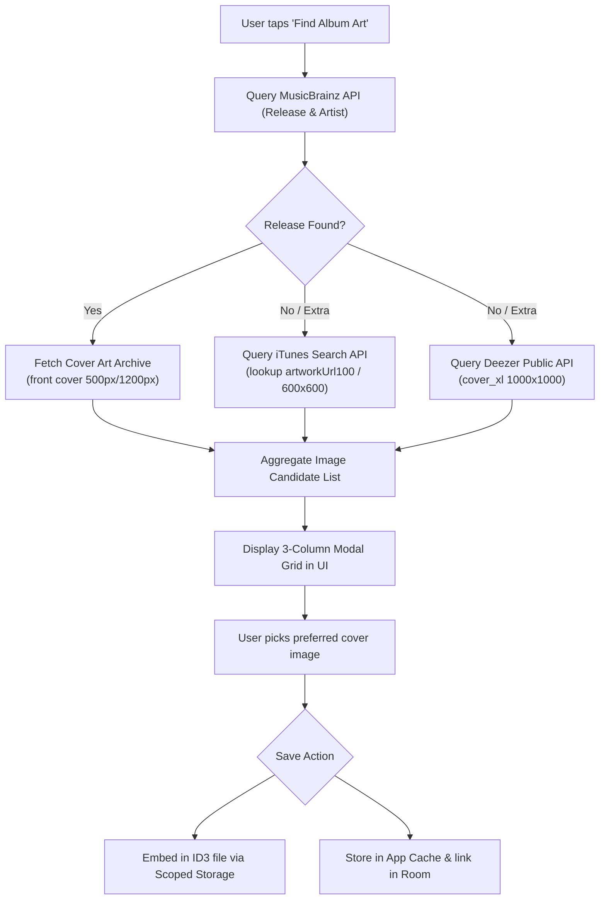

# Online Integrations, APIs & Privacy Specification — Pulse

## 1. Integration Principles & Privacy Policy

Pulse is fundamentally an **offline-first** audio player. Online features exist solely to enrich user-owned media (fetching missing lyrics, discovering album artwork, cleaning corrupted metadata, and recognizing ambient songs).

1. **Strict User Consent**: No network requests occur without explicit user opt-in via a first-run privacy consent dialog (**"Allow Online Metadata Fetching"**).
2. **Graceful Offline Degradation**: Every screen, button, and flow functions 100% offline. Network failures yield clean, non-blocking UI notifications.
3. **No Tracking / No Telemetry**: Pulse contains zero analytics SDKs, advertising beacons, or telemetry collectors. User data never leaves the device unless triggered by an explicit user action.
4. **Secure Key Management**: User-supplied API keys (Gemini, AudD, ACRCloud) are encrypted on-device using the **Android Keystore system** via `EncryptedSharedPreferences`.

---

## 2. Gemini Generative AI Integration

### 2.1 Configuration & Key Storage
- **Location**: **Settings > Lyrics and Online > Gemini API Key**.
- **Security**: The raw API key string is passed to `MasterKeys.getOrCreate(MasterKeys.AES256_GCM_SPEC)` and stored securely in private app storage.
- **Validation**: Includes a **"Test API Key"** button that sends a minimal ping (`"Ping: Respond with PONG"`) to verify quota and credentials before saving.

### 2.2 Feature 1: Fallback Lyrics Generation (Unverified)
- **Execution Rule**: Gemini is queried **only** as a last resort when:
  1. No embedded ID3 `USLT`/`SYLT` tags exist in the file.
  2. No `.lrc` sidecar file is found in the track directory.
  3. No cached record exists in Room.
  4. The LRCLIB online database returns HTTP 404.
- **Copyright & Hallucination Guardrail**:
  - LLMs may hallucinate lyrics or refuse to output copyrighted song text.
  - Pulse's system prompt requests structured verse/chorus lyrics while instructing the model to decline if uncertain.
  - **UI Labeling**: In the Lyrics view, Gemini results are highlighted with an amber pill: `⚠️ AI-Generated Lyrics (Unverified)`. Users can review, edit, or reject the lyrics before committing them to local cache.
- **System Prompt**:
```text
You are a music metadata assistant. Output the exact lyrics for the song "{title}" by "{artist}". 
Do not include commentary, greetings, or conversational filler. 
If you do not know the exact lyrics or if policy restricts providing full copyrighted lyrics, 
respond strictly with: "LYRICS_UNAVAILABLE".
```

### 2.3 Feature 2: Smart Tag Disambiguation & Metadata Cleanup
- When a user selects a poorly tagged audio file (e.g. `track01_rip_final.mp3`), the user can tap **"Suggest Metadata with AI"**.
- Gemini analyzes available file clues (filename, directory hierarchy, partial tags) and returns structured JSON:
```json
{
  "title": "Bohemian Rhapsody",
  "artist": "Queen",
  "album": "A Night at the Opera",
  "year": 1975,
  "genre": "Rock",
  "trackNumber": 11
}
```
- **Safety Gate**: Pulse never overwrites tags automatically. The suggested metadata is presented in the Tag Editor for user review and explicit confirmation.

---

## 3. Lyrics Resolution: LRCLIB API

For accurate, community-verified synchronized and unsynchronized lyrics, Pulse integrates with **LRCLIB** (a free, open-source lyrics database).

- **Base URL**: `https://lrclib.net/api/`
- **Rate Limit**: Polite client etiquette (~2 requests per second max; strictly throttled).
- **Endpoint**: `GET /api/get`
- **Query Parameters**:
  - `track_name`: Cleaned song title
  - `artist_name`: Artist name
  - `album_name`: Album name (optional)
  - `duration`: Track duration in seconds (enables high-precision duration matching)
- **Response Handling**:
  - If `syncedLyrics` exists: Parsed into timestamped lines (`[mm:ss.xx]`) and rendered in synchronized view.
  - If only `plainLyrics` exists: Rendered in clean static scrollable view.
  - Response payload is cached in Room database `lyrics_cache` table to eliminate repeated network queries.

---

## 4. Album Artwork Discovery: Multi-Provider Pipeline

Gemini cannot reliably download high-resolution binary image files. Pulse uses a specialized artwork retrieval pipeline:



### Supported Artwork Providers:
1. **MusicBrainz + Cover Art Archive (CAA)**:
   - Queries `https://musicbrainz.org/ws/2/release/` to identify the release MBID.
   - Fetches original high-resolution master cover from `https://coverartarchive.org/release/{mbid}/front`.
2. **iTunes Search API**:
   - `https://itunes.apple.com/search?term={query}&entity=album&limit=5`
   - Yields high-quality 600x600 and 1200x1200 artwork URLs.
3. **Deezer Public API**:
   - `https://api.deezer.com/search/album?q={query}`
   - Yields uncompressed `cover_xl` images (1000x1000).

---

## 5. Song Recognition: Acoustic Fingerprinting

Pulse provides ambient acoustic song identification ("What's this song?") without compromising on audio accuracy.

### 5.1 Provider Selection: AudD vs. ACRCloud
Because Gemini is a large language model and **not** an audio fingerprinting service, Pulse supports true acoustic fingerprinting providers:

| Provider | Integration Type | Free Tier Limits | Advantages |
|---|---|---|---|
| **AudD** (Default) | REST API (POST multipart PCM audio snippet) | 300 free requests (developer key) | Simple REST interface, rapid matching (< 3s), returns Spotify/Apple Music IDs. |
| **ACRCloud** | Native SDK or REST Signature | 100 free requests/day | Extremely high accuracy with background noise; extensive international catalog. |

Users enter their personal API token in **Settings > Song Recognition**.

### 5.2 Microphone Capture & Processing Flow
1. User taps the **Waveform/Mic** button.
2. App checks `RECORD_AUDIO` permission. If ungranted, displays a transparent rationale dialog.
3. Pulse records 10–12 seconds of mono 16-bit 44.1kHz PCM audio into a short-lived memory buffer.
4. UI displays an animated pulsing circular waveform in the user's warm accent color (no blue gradients).
5. Audio snippet is transmitted via HTTPS POST to the recognition provider.
6. The memory buffer is wiped immediately.
7. Result card shows Title, Artist, Album, and Cover Art, with quick shortcuts to search local library or open web link.
