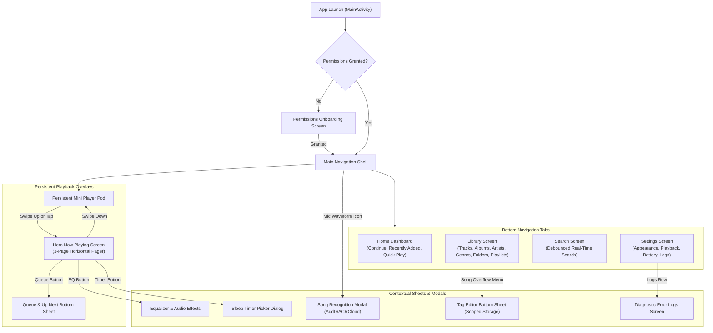

# UX Flows, Navigation & Interaction Architecture — Pulse

## 1. Screen Map & Application Navigation Graph

Pulse organizes its functionality into a concise bottom navigation hierarchy, complemented by modal sheets and a persistent floating mini-player.



---

## 2. Gesture Mapping & Physics

Pulse relies on natural tactile gestures to minimize tap hunting:

| Component | Gesture | Action / Result | Physics / Response |
|---|---|---|---|
| **Mini Player** | Tap | Expands into full Now Playing screen | Shared-element expansion (380ms) |
| **Mini Player** | Swipe Up | Expands into full Now Playing screen | Velocity-tracked modal expansion |
| **Mini Player** | Swipe Left | Skips to Next Track | Spring slide transition + light haptic |
| **Mini Player** | Swipe Right | Executes Smart Previous (Restart / Prev) | Spring slide transition + light haptic |
| **Now Playing** | Swipe Down | Collapses full player back to Mini Player | Spring collapse with boundary friction |
| **Now Playing** | Horizontal Swipe | Pages between Player, Lyrics, and Art Viewer | Page indicator sync + smooth scroll |
| **Album Art Viewer**| Pinch / Spread | Zooms into high-resolution artwork | Rubber-band bounds (0.8x to 3.5x zoom) |
| **Lyrics Line** | Tap | Direct audio seek to clicked lyric timestamp | Subtle highlight pulse + instant audio sync |
| **Queue Item** | Long Press & Drag | Reorders track position in queue | Elevation lift (8dp) + medium haptic |
| **Queue Item** | Swipe Left/Right | Removes track from queue | Swipe-to-dismiss + snackbar with Undo |
| **Library List** | Fast-Scroll Drag | Scans through alphabet index | Alphabet bubble popup with tick haptics |

---

## 3. Screen States & Visual Feedback

Every screen in Pulse strictly accounts for four core UI states: **Loading**, **Content**, **Empty**, and **Error**.

### 3.1 Empty States
- **Library (No Audio Files Found)**:
  - Visual: Ambient outline illustration of headphones with clean typography.
  - Message: *"Your library is quiet. Copy audio files to your device or check folder inclusions."*
  - CTA Button: `[Scan Folders]` or `[Include Folder]`.
- **Search (No Matches)**:
  - Visual: Magnifying glass illustration.
  - Message: *"No results matching '[query]'. Check spelling or search by album/artist."*
- **Lyrics (No Lyrics Found)**:
  - Visual: Stylized music note icon.
  - Message: *"No synchronized lyrics found for this track."*
  - CTA Button: `[Search Online (LRCLIB)]` and `[Edit Lyrics Manually]`.

### 3.2 Loading States
- **Library Scanning**:
  - Top progress shimmer bar with animated track count counter (`Scanning... 420 tracks found`).
- **Initial Screen Load**:
  - Subtle skeleton placeholder cards matching exact dimensions of track rows and album art to avoid layout shift (CLS = 0).

### 3.3 Error & Permission States
- **Permission Denied (Storage / Audio)**:
  - Informative screen: *"Pulse needs permission to read your audio files to play your local music."*
  - Action Button: `[Grant Permission]` (or deep link to App Settings if permanently denied).
- **Format Incompatible**:
  - Non-blocking snackbar: *"This audio format is not currently supported on your device."*
  - Action: `[View Details]` showing format specs and option to enable FFmpeg decoder.

---

## 4. Haptic Feedback Design

Haptics provide physical confirmation for high-importance interactions (with a toggle in **Settings > Appearance > Haptic Feedback** to disable):

- **Light Tick (`HapticFeedbackType.TextHandleMove`)**:
  - Alphabet index scrubber ticking over letters.
  - Seek bar thumb passing minute marks.
- **Medium Click (`HapticFeedbackType.LongPress`)**:
  - Play/Pause toggle tap.
  - Long-press on track to open actions menu.
  - Queue drag handle pickup and drop.
- **Double Soft Tap**:
  - Smart Previous double-tap confirmation.
- **Heart Pop**:
  - Tapping Favorite heart icon (synchronized with heart burst animation).

---

## 5. Adaptive Layouts (Tablet & Landscape)

Pulse provides responsive layouts for wide screens and landscape orientations:

```
+-------------------------------------------------------------------------------+
| TABLET / WIDE SCREEN (> 600dp) TWO-PANE LAYOUT                                 |
+---------------------------------------+---------------------------------------+
| LEFT PANE: Library / Content          | RIGHT PANE: Persistent Now Playing    |
|                                       |                                       |
| [Tracks | Albums | Artists | Folders] |           +---------------+           |
|                                       |           |   HERO ART    |           |
| [Track 1]                             |           |   (240x240dp) |           |
| [Track 2]                             |           +---------------+           |
| [Track 3]                             |                                       |
| [Track 4]                             | Song Title Here                       |
| [Track 5]                             | Artist • Album                        |
| [Track 6]                             | [================O==================] |
| [Track 7]                             | [Shuffle] [|<<] [>||] [>>|] [Repeat]  |
|                                       |                                       |
|                                       | UP NEXT IN QUEUE:                     |
|                                       | [1. Next Song]                        |
|                                       | [2. Upcoming Track]                   |
+---------------------------------------+---------------------------------------+
```

- When width exceeds 600dp, the layout transitions from a bottom mini-player modal to a permanent two-pane split: browsing list on the left, full hero player and queue on the right.
